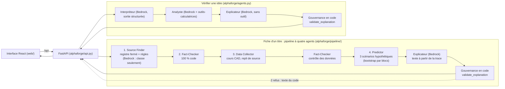

# ReelBroker — Documentation technique

Datathon PolyFinances 2026, cas « AlphaForge AI ». Simulation seulement : ce document décrit une aide à l'analyse, pas un conseil financier personnalisé. Le rendement passé ne garantit pas le rendement futur.

Chiffres de ce document : produits en exécutant le code du dépôt le 15 novembre 2026 (univers de 91 actifs, dont 31 du jeu de départ, du 2021-11-12 au 2026-11-12, devise CAD). Les textes Bedrock cités viennent du cache `data/cache/pipeline/*.json`.

## 1. Principe

**Le code calcule, le modèle explique.** Aucun nombre n'est produit par un modèle de langage. Chaque chiffre affiché vient d'une fonction de `alphaforge/` et porte sa source et sa fenêtre de dates. Les modèles (Claude sur Amazon Bedrock, via Strands Agents) ne font que trois choses : lire une phrase libre, classer des sources d'un registre fermé, rédiger une explication à partir d'une trace de calcul. Une **gouvernance écrite en code** vérifie ensuite chaque texte.

La boucle produit est : **Connaître** (questionnaire adaptatif, profil déclaré) → **Décider** (scénarios fictifs, vérification d'une idée, fiche d'un titre) → **Apprendre** (profil déclaré et profil révélé côte à côte).

## 2. Agents : rôles et interactions

Chaque agent a une raison d'exister et un contrôle. Il n'y en a pas plus que nécessaire : l'interpréteur et l'explicateur sont séparés exprès, et la gouvernance n'est pas un modèle.

### 2.1 Fiche d'un titre (`GET /api/card/{ticker}`, `POST /api/pipeline/run`)

| Agent | Rôle | Ce qui est du code / du modèle | Contrôle |
|---|---|---|---|
| Source Finder (`pipeline/source_finder.py`) | Choisit, dans un **registre de 6 sources publiques** (`starter`, `yfinance`, `boc_valet`, `sec_edgar`, `sedar_plus`, `issuer_esg_esgv`), celles qui servent ce titre : cours, taux de change si coté en USD, taux directeur, états financiers (SEC pour un titre américain, SEDAR+ pour un canadien), méthodologie ESG pour ESGV. Chaque source porte `license`, `as_of`, `chosen_because`. | Règles en code. Bedrock peut seulement **classer et justifier** des entrées du registre. | Tout identifiant hors registre est écarté et journalisé (`ignored_outside_registry`) ; le modèle ne peut retirer aucune source ; le fichier officiel du datathon reste la source primaire de prix. |
| Fact-Checker (`pipeline/fact_checker.py`) | Avant la collecte : source dans le registre, URL conforme au domaine du registre, titre existant. Après : fenêtre et devise déclarées, `adj_close` utilisé, aucun prix ≤ 0, aucun trou de plus de 7 jours de bourse, concordance avec une seconde source si elle existe (écart de niveau < 1 %, écart médian des rendements quotidiens < 0,005). | Entièrement en code. | Une vérification échouée **bloque** la source ; le collecteur passe à la suivante. Il ne certifie rien : il rapporte « passé / échoué » avec le détail. |
| Data Collector (`pipeline/data_collector.py`) | Lit les cours du jeu de départ (convertis en CAD) ou Yahoo Finance si `use_network=True` (cache local). Note l'historique court, les sources écartées, l'artefact CNQ.TO. | Code. Ne plante jamais sur une panne réseau : repli et note. | Devise inconnue : conversion **refusée** plutôt que devinée. |
| Predictor (`pipeline/predictor.py`) | Trois scénarios hypothétiques sur 5 ans (voir § 4.4). Nommé ainsi pour des raisons historiques : il ne prédit rien. | Code seulement. | Jamais une médiane seule : fourchette, part sous la mise de départ, grille de sensibilité, limites, avertissement. |
| Explicateur (`pipeline.explain_outlook`) | Rédige un résumé et une explication d'environ 120 mots. | Bedrock. Reçoit la liste fermée de « NOMBRES AUTORISÉS » déjà formatés. | Gouvernance (§ 3). |

La trace partagée (`pipeline/_trace.py`) est une liste d'entrées `{agent, step, tool, inputs, outputs, ms}` alimentée par tous les agents ; elle est renvoyée dans `pipeline.trace` et affichée dans « Comment ces chiffres ont été obtenus ».

### 2.2 « Vérifier une idée » (`POST /api/check`)

| Agent | Rôle | Contrôle |
|---|---|---|
| Interpréteur (`agents.interpret`) | Traduit la phrase (« je veux mettre 20 % dans Tesla ») en intention structurée (modèle Pydantic `Intention`). Un modèle est nécessaire : le texte libre ne se lit pas avec des règles. | Les tickers hors liste sont supprimés ; il ne doit pas inventer la part (sinon : question de clarification). |
| Analyste (`agents.analyse`) | Choisit quels calculs lancer parmi six outils (`profil`, `lister_titres`, `verifier_idee`, `mesures_titres`, `correlations`, `comparer_options`) et les lance. N'a que des calculatrices. | Chaque appel d'outil est enregistré dans `Context.trace` (outil, entrées, sortie, fenêtre de données) : c'est le **reçu de décision**. |
| Explicateur (`agents.explain`) | Rédige à partir de la **seule trace**. Sans outil ni accès aux données : il ne peut citer que ce qui a été calculé. | Gouvernance (§ 3). |
| Gouvernance | Du code, pas un modèle : un modèle qui se relit lui-même ne prouve rien. | `validate_explanation`. |

Le verdict (compatible / en tension / en conflit) et les contrôles de profil sont calculés par `decide.check_intention`, **avec ou sans modèle**. Un hors-sujet reçoit un refus poli ; si aucun calcul n'a pu être lancé, le système répond qu'il ne peut rien affirmer.

Sans identifiants AWS, ou après une panne Bedrock, `agents.run` retombe sur une lecture par mots-clés (`decide.parse_intention`, regex) et un texte produit par le code ; le mode (`bedrock`, `offline`, `offline_after_error`) est renvoyé et affiché (« Amazon Bedrock » ou « Texte de secours (hors ligne) »).

## 3. Contrôles et gouvernance

`agents.validate_explanation(text, trace, extra_allowed)` est déterministe et testé (`tests/test_agents.py`). Il rejette un texte pour l'une de ces raisons :

1. **Un nombre absent de la trace.** Chaque nombre du texte doit exister dans la trace, tel quel ou en pourcentage (×100), à l'arrondi du texte près ; formats français acceptés (« 1 944 $ », « 12,9 % », « −6,0 % »). Un signe moins explicite exige une valeur négative dans la trace. Seuls les petits entiers (≤ 5) et les années, quand ils ne sont ni pourcentage ni montant, sont exemptés. Les `extra_allowed` (centiles 5, 10, 50, 90, 95, nombre de trajectoires, etc.) sont des paramètres de méthode autorisés tels quels.
2. **Une formule de conseil** : « vous devriez », « achetez », « vendez », « je recommande », « rendement assuré »…
3. **Une formule de prévision ou de certitude** : « va monter/atteindre/rapporter… », « rendement attendu », « à coup sûr », « prix cible », « potentiel de hausse »… Les formules niées (« ne garantit pas », « pas une prévision », « sans risque » nié) sont permises (`NEGATABLE_PATTERNS`, négation dans la même phrase).

Exemple mesuré (trace de Robert, voir § 6) :

| Texte soumis | Résultat |
|---|---|
| « La volatilité passerait de 6,0 % à 13,0 %. » | accepté |
| « La volatilité passerait de 6,0 % à 9,1 %. » | rejeté : `chiffres introuvables dans la trace des outils : 9,1` |
| « Vous devriez réduire à 7 %. » | rejeté : formulation de conseil détectée |
| « Tesla va monter de 30 %. » | rejeté : `30` introuvable, formulation de prévision |

**Séquence de reprise.** Pour la fiche d'un titre : tentative 1 ; en cas de refus, tentative 2 avec les motifs du refus dans le prompt ; si la deuxième échoue (ou en cas d'erreur / de délai), **repli sur le texte déterministe écrit par le code** (`fell_back_to_deterministic: true`). La trace est figée **avant** les tentatives : un texte rejeté ne légitime aucun nombre. Chaque tentative (acceptée ou refusée, avec motifs) est inscrite dans `governance.attempts_log` et affichée dans l'interface. Pour « Vérifier une idée » : même logique, deux rédactions puis texte du code.

**Délai dur.** Chaque appel Bedrock du pipeline s'exécute dans un fil avec un délai de 45 s (`pipeline/_timeout.py`) ; au dépassement, `TimeoutError`, tentative notée comme échouée, repli. Une réponse Bedrock prend environ 17 s.

**Autres contrôles.**
- Sources : registre fermé, domaine d'URL vérifié, licences affichées, aucune republication des CSV bruts (`data/raw/` hors Git).
- Simulation : aucun point d'API n'envoie un ordre ; `simulated: true` sur chaque achat ; bandeau permanent « Simulation, pas un conseil » dans l'interface ; libellé « Adéquation au profil » à la place de tout verdict d'achat.
- Pas de raisonnement interne exposé : l'interface montre la trace de calcul, jamais une chaîne de pensée du modèle.
- Garde-fou Bedrock Guardrails branchable sans changer le code (`BEDROCK_GUARDRAIL_ID`) ; **non activé** dans la démonstration.
- Mémoire : cache `data/cache/pipeline/` clé `fin de fenêtre | modèle | version`. Un texte en cache est **revalidé** avant réutilisation.

## 4. Méthodes et pourquoi

### 4.1 Niveau de risque (profil → budget)

Le profil sépare quatre notions que la littérature et le jury distinguent : **tolérance** (volonté, déclarée), **capacité** (calculée par le code d'après revenu, coussin de sécurité et retraits prévus), **horizon**, **objectif**. Le niveau retenu (1 à 5) est **le plus bas des quatre** (`InvestorProfile.effective_risk`). Pourquoi : « tolérance élevée » ne doit jamais annuler une capacité faible, un horizon court ou un objectif de préservation.

| Niveau | Plafond de volatilité annuelle | Part maximale d'actifs de croissance |
|---|---|---|
| 1 très faible | 4 % | 20 % |
| 2 faible | 7 % | 40 % |
| 3 modéré | 10 % | 60 % |
| 4 élevé | 14 % | 85 % |
| 5 très élevé | 18 % | 100 % |

Plafond d'horizon : < 1 an → 1 ; < 3 → 2 ; < 5 → 3 ; < 10 → 4 ; sinon 5. Plafond d'objectif : préserver 2, projet 3, revenu ou équilibre 4, croissance 5. **Ces valeurs sont nos hypothèses**, lisibles dans `profile.py` et affichées dans le panneau « Toutes nos hypothèses ». Résultat sur les personas : Amira 4 (tolérance 5, capacité 4 limite active), Mateo 3, Robert 2 (tolérance 3, capacité 4, plafond d'objectif 2).

### 4.2 Allocation : diversification maximale sous contraintes (`allocate.py`)

- **Objectif** : maximiser le ratio de diversification (somme pondérée des volatilités / volatilité du portefeuille), pas le rendement. Pourquoi : les rendements espérés sont l'entrée la plus fragile d'un optimiseur ; un optimiseur de rendement empile les gagnants passés (essai sur les données : XOM, CNQ, NVDA), exactement ce que l'énoncé met en garde. Les rendements, quand ils servent (`max_utility`), sont rétrécis de 75 % vers un prior proportionnel au risque.
- **Bande de volatilité, pas seulement un plafond** : la volatilité visée est entre 85 % et 100 % du plafond du niveau. Sans plancher, un profil à risque élevé reçoit un portefeuille timide (la diversification pure donne environ 7 % de volatilité à Amira). Une seconde passe réoptimise après suppression des positions poussière pour que la bande soit réellement atteinte.
- **Plafonds** : 10 % par société, 5 % par cryptoactif, plafond du profil par fonds, **20 % par secteur** pour l'ensemble des actions individuelles d'un même secteur (`data.SECTOR_CAP`), plafond d'actifs de croissance du niveau, poids minimal 2 %. Les quasi-liquidités (ZST.TO) peuvent dépasser le plafond par titre.
- **Covariance rétrécie** de 10 % vers la diagonale (`metrics.cov_matrix`) pour stabiliser l'estimation.
- **Contraintes dures, préférences souples** : exclusions = contraintes ; centres d'intérêt (ex. IA, techno, crypto pour Amira) = inclinaison bornée plus un plancher combiné de 15 % quand c'est faisable ; « à éviter si possible » = pénalité, jamais interdiction.
- **Trois scénarios** (`decide.options`) : un cran plus prudent, aligné, un cran plus exposé (hors profil, montré pour comparaison, étiqueté comme tel).

Portefeuilles alignés obtenus (période 2021-11-12 → 2026-11-12, CAD, rééquilibrage trimestriel) : Amira (niveau 4), volatilité 12,2 %, pire baisse −13,5 %, rendement annualisé passé 19,3 %, Sharpe 1,22, 20 positions dont BTC-USD 3,2 % et ETH-USD 2,6 %, plus grande position TLT 15 % ; Mateo (niveau 3), 8,6 %, −14,7 %, 7,9 %, Sharpe 0,54, 6 positions (ESGV 31,1 %, SHY 20,6 %, GLD 20,1 %, TLT 19,4 %, ZST.TO 5,0 %, XRE.TO 3,8 %, ce dernier un FNB immobilier non filtré ESG, permis mais signalé « à éviter ») ; Robert (niveau 2), 6,1 %, −6,2 %, 8,5 %, Sharpe 0,81, 12 positions, plus grande position SHY 35 %. Univers de 91 actifs. **Ces rendements décrivent le passé de la fenêtre, avec le biais du survivant ; ils ne sont pas une promesse.**

### 4.3 Vérification d'une idée (`decide.check_intention`)

Pour « x % dans le titre T », le code recalcule le portefeuille après l'idée et nomme chaque écart : exclusion, plafond par titre, plafond de volatilité (covariance rétrécie), part d'actifs de croissance, part du risque (un titre qui pèse 20 % de l'argent mais 81 % du risque), horizon (pire baisse du titre et durée passée sous son sommet comparées à l'horizon du profil), objectif. Le verdict est le pire statut (ok < avertissement < conflit). Il calcule aussi **la plus grande part qui reste dans les limites** (balayage de 1 % en 1 %), une borne et non une suggestion. Tout cela est du code ; aucun modèle ne décide du verdict.

### 4.4 Scénarios à 5 ans : bootstrap par blocs avec dérive réduite (`predictor.outlook`)

Le défi demande de ne pas prédire les rendements futurs à partir du passé. On ne présente donc **jamais une prévision** :
- rendements mensuels logarithmiques historiques, recentrés, rééchantillonnés par **blocs circulaires de 3 mois** (conserve un peu d'autocorrélation et de grappes de volatilité), 2 000 trajectoires, graine fixe 0 ;
- la **dérive** est remplacée par `0,75 × prior de type MEDAF + 0,25 × historique`, où prior = taux directeur de la Banque du Canada moyen de la fenêtre (3,19 %) + bêta × prime de risque supposée 5 %. Le bêta est estimé sur les rendements quotidiens CAD contre XIU.TO (titres cotés à Toronto) ou SPY (autres) ;
- trois scénarios = centiles 90 (favorable), 50 (central, appelé « Notre scénario central », jamais « prédiction »), 10 (défavorable), plus la part des trajectoires sous la mise de départ ;
- **grille de sensibilité** (réduction 50 / 75 / 100 % × prime de risque 3 / 5 / 7 %) : pour TSLA, le scénario central va de −7,0 % à 1,7 % par an, ce que le texte dit : « il dépend surtout de ces hypothèses, pas seulement des données » ;
- limites écrites : le rééchantillonnage ne contient aucun événement absent de la fenêtre ; un bêta élevé avec un historique plat reçoit tout de même une dérive élevée ; frais, impôts, inflation et change non modélisés.

La prime de risque de 5 % est une **hypothèse déclarée, pas un fait sourcé**.

### 4.5 Déclaré et révélé (`learn.py`)

Le profil déclaré vient du questionnaire ; le profil révélé vient des décisions prises dans l'application (idée gardée malgré un conflit, scénario choisi, réaction à une vraie baisse historique). Règles : au moins 3 décisions avant toute conclusion ; tolérance révélée = médiane des 5 dernières ; **seule la tolérance** peut bouger, par un clic explicite ; elle reste plafonnée par la capacité, l'horizon et l'objectif (Robert reste au niveau 2 quoi qu'il fasse) ; les deux profils ne sont jamais fusionnés en silence ; décisions contradictoires signalées. Pourquoi : un comportement n'est pas une capacité financière.

### 4.6 Ordre du fil (`feed.build_feed`)

Chaque titre apparaît une seule fois, dans un ordre calculé par le code ; le fil se termine par une carte « Vous avez vu les N titres analysés ». Clés de tri, dans l'ordre :

1. **Verdict** à une part de 5 % : compatible, puis en tension, puis en conflit. Les titres en conflit restent visibles, en dernier et étiquetés, pour que le système puisse expliquer pourquoi un titre à la mode ne convient pas.
2. **Préférences « à éviter »** : ces titres descendent. Les **exclusions strictes** les retirent du fil.
3. **Thèmes d'intérêt** déclarés (question C6) : ces titres montent.
4. **Pour et Contre** : un titre semblable à un titre aimé monte, semblable à un titre rejeté descend (secteur, type d'actif, corrélation).
5. **Risque du titre pour ce profil** (`risk_gap`) : un titre dont la volatilité historique dépasse le double du plafond de volatilité du profil descend, par paliers de 5 points. Chez Robert (plafond 7 %), Tesla est à la 74e place sur 91 titres. Chez Amira, le fil de 90 titres commence par MSFT, AAPL, BTC-USD, NVDA ; chez Mateo (24 titres), par ESGV, ZST.TO, SHY, ZAG.TO ; chez Robert, par ZST.TO, SHY, ZAG.TO, XBB.TO.
6. **Diversification** : à égalité, le titre le moins corrélé au portefeuille de départ passe d'abord.

Aucune de ces clés ne change un verdict ni un plafond : elles ne font que trier. Le multiple 2 et les paliers de 5 points sont des hypothèses, listées dans « Toutes nos hypothèses ».

## 5. Données : sources, actifs, traitements, hypothèses

**Source principale** : jeu de départ des organisateurs (`data/raw/datathon2026/.../alphaforge_starter/`), du 2021-11-12 au 2026-11-12, extrait le 2026-11-13 : 31 actifs (10 actions canadiennes, 10 américaines, 9 FNB, BTC, ETH). Prix Yahoo Finance via `yfinance`, taux USD/CAD et taux directeur de la Banque du Canada (API Valet), séries FRED. Aucun appel réseau n'est nécessaire pour reproduire les résultats. Détail des licences : README, « Sources de données ».

**Univers étendu (notre propre extraction, pas des données des organisateurs)** : `scripts/build_extended_universe.py` télécharge avec `yfinance` 60 titres de plus (20 actions canadiennes, 25 américaines, 15 FNB, aucune cryptomonnaie) sur la même fenêtre, `Adj Close` avec `auto_adjust=False` comme le script des organisateurs. Les fichiers (`prices_daily.csv`, `assets_universe.csv`, `provenance.json`, `quality_report.csv`) sont dans `data/processed/extended/`. Règles de rejet, journalisées : historique plus court que la fenêtre, trou de plus de 7 jours de bourse, prix non positif ; les 60 titres demandés ont tous passé (aucun rejet). `quality_report` : aucun prix non positif, aucun jour de rendement suspect, trou maximal de 5 jours calendaires. `data.load_universe` fusionne les deux jeux et applique exactement le traitement de `load_starter` (même calendrier, même conversion en CAD) ; le jeu de départ gagne en cas de doublon et reste la source primaire dans l'agent Source Finder. Pour un titre étendu, l'agent Source Finder nomme « univers étendu ReelBroker (Yahoo Finance via yfinance) » et le Vérificateur de faits ne compte **aucun recoupement avec yfinance** : même fournisseur, un accord ne prouverait rien (le contrôle `recoupement_independant` l'indique : « Non applicable »). Fenêtre commune : l'ajout ne raccourcit aucune fenêtre (tous les titres ont l'historique complet).

**Traitements** (`data.load_starter`, journalisés, rapport `quality_report`) :
- `adj_close` seulement (dividendes et fractionnements déjà appliqués) ;
- **conversion en CAD** avec le taux USD/CAD de la Banque du Canada, dernier taux reporté les jours fériés canadiens ;
- **alignement de calendrier** : les cryptos se négocient 7 jours sur 7 ; on garde les jours où au moins une bourse est ouverte, avec remplissage par le dernier cours limité à 3 jours ;
- taux sans risque du Sharpe = moyenne du taux directeur sur la fenêtre (3,19 %), non 0 ;
- fenêtre commune des actifs d'un portefeuille : un actif à courte histoire raccourcit la fenêtre (limite connue), et un actif de moins d'un an est écarté de l'optimisation.

**Pièges documentés** :
- **CNQ.TO** : un « fractionnement » de 1,021 le 2022-08-22, probablement une distribution spéciale. Le collecteur l'ajoute en note pour ce titre ; les rendements autour de cette date sont à lire avec prudence.
- **Biais du survivant, aussi pour l'univers étendu** : l'univers de départ et nos 60 titres ont été choisis en 2026 parmi des titres connus, liquides et encore importants ; aucun titre disparu, fusionné ou déclassé depuis 2021 n'y figure. Les rendements passés des 91 actifs sont plus flatteurs qu'un choix fait en 2021 ; la liste étendue ne corrige pas ce biais, elle le reproduit. C'est écrit dans les hypothèses de chaque scénario.
- **Pas de cotes ESG, de nouvelles ni de fondamentaux** dans le jeu de départ. Le critère de Mateo (éviter les sociétés à controverses importantes) n'est donc **pas vérifiable** sur les sociétés individuelles : elles portent l'étiquette `esg_unverified`, et avec une règle stricte elles sont exclues pour **« donnée insuffisante »** (jamais déclarées conformes). ESGV est `esg_screened` : filtre décrit par son émetteur (méthodologie dans le registre), qui n'est pas une garantie sur chaque société détenue ; XIU, SPY et QQQ sont `esg_unscreened_fund`. Coût visible : le portefeuille de Mateo compte 6 positions et une pire baisse de −14,7 %, diversification plus faible. Méthodologie d'ESGV citée depuis la page du fonds chez Vanguard (indice FTSE US All Cap Choice : exclusions d'activités dont énergies fossiles, armes, tabac et nucléaire ; filtre de conduite sur le travail, les droits de la personne, l'environnement et l'anti-corruption, y compris la gravité des controverses ; critères de diversité), lue le 2026-11-15, voir `docs/esg-evidence.md`. Aucune donnée ESG par société : les sociétés restent exclues pour « donnée insuffisante ». Notre lecture de « peu d'intérêt pour la spéculation » exclut aussi les cryptoactifs pour Mateo.
- **Données macro** : IPC mensuel daté au mois de référence, non utilisable avant sa publication ; non utilisé dans les calculs affichés.

## 6. Explicabilité : un exemple de bout en bout (Robert, 20 % dans Tesla)

Mécanisme : chaque réponse porte (a) la **trace** des calculs (outil, entrées, fenêtre de données), (b) le **texte** rédigé, (c) le **contrôle** (`governance.passed`, `numbers_checked`, tentatives). Les quatre questions du jury sont couvertes : quelles données (trace + fenêtre), pourquoi ce verdict (liste de contrôles), quelles limites (hypothèses et limites affichées), qu'est-ce qui changerait la réponse (la borne de 7 % pour Robert, le niveau de risque, l'horizon).

**Scénario.** Robert, 59 ans, objectif préserver le capital, horizon 3 ans, tolérance 3, capacité 4 → niveau retenu 2 (plafond d'objectif) ; crypto à éviter. Il écrit « je veux mettre 20 % dans Tesla ». Exécuté en processus avec le client de test FastAPI **sans variable AWS** (mode hors ligne déterministe, calculs identiques au mode Bedrock) :

`POST /api/check {"profile_id": "robert", "text": "je veux mettre 20 % dans Tesla"}`

Conclusion : **« En conflit avec le profil déclaré »**, part maximale dans les limites : **7 %** (5 % avant l'extension de l'univers à 91 actifs). Chaque élément se relie à une entrée de la trace :

| Conclusion affichée | Entrée de la trace (outil `verifier_idee`, fenêtre 2021-11-12 → 2026-11-12) |
|---|---|
| « 20 % dans un seul titre dépasse le plafond de 10 % » | `limites_du_profil.single_cap = 0.1` ; entrée `part_pct = 20` |
| « La volatilité estimée passerait de 6,0 % à 13,0 %, au-dessus du plafond de 7 % » | `portefeuille_avant.volatilite_estimee` (6,0 %) ; `portefeuille_apres.volatilite_estimee` (13,0 %) ; `limites_du_profil.max_vol = 0.07` (niveau 2) |
| « Ce titre pèserait 20 % de l'argent, mais 84 % du risque » | `portefeuille_apres.part_du_risque_du_titre` (84 %) |
| « Les actifs de croissance atteindraient 52 %, limite 40 % » | `portefeuille_apres.actifs_de_croissance = 0.52` ; `limites_du_profil.max_growth_assets = 0.4` |
| « Tesla a déjà perdu 71 % et a mis 2,9 an(s) à retrouver son sommet » (horizon 3 ans) | `titre_seul.pire_baisse` (−71 %) ; `titre_seul.annees_sous_le_sommet = 2.9` ; Tesla varie environ 8 fois plus que le plafond de volatilité du profil |
| « Jusqu'à 7 % resterait dans les limites » | `part_maximale_dans_les_limites_pct = 7` |
| Pire baisse en dollars (illustration sur 10 000 $) | avant 623 $, après 1 484 $ (`pire_baisse_en_dollars` ; pires baisses historiques −6,2 % et −14,8 %) |

Le texte passe `validate_explanation` (`passed: true`, aucune formulation de conseil) ; un chiffre qui s'écarterait de ces valeurs serait rejeté (voir le tableau du § 3). Le message ne dit jamais « n'achetez pas » : il montre l'écart, la borne calculée, et laisse la personne décider. La décision prise (« garder », « ramener dans les limites », « abandonner ») est inscrite au journal de l'étape Apprendre ; la garder malgré un conflit révèle un niveau de risque plus élevé, mais Robert reste plafonné au niveau 2.

Une trace équivalente pour la fiche d'un titre (`POST /api/pipeline/run`, TSLA hors ligne) : `source_finder.find_sources` (4 sources : starter, yfinance, boc_valet, sec_edgar) → `fact_checker.check_source` (passé) → `data_collector.fetch_starter` (1 282 observations) → `fact_checker.check_data` (passé ; plus grand trou 2 jours de bourse) → `predictor.outlook` (défavorable −28,2 %, central −1,8 %, favorable 30,9 % par an, 53,1 % des trajectoires sous la mise de départ) → `explainer.explain_outlook` (20 nombres vérifiés).

## 7. Validation

**Tests.** Exécutés le 15 novembre 2026 :
- `.venv\Scripts\python -m pytest -q` : **169 réussis**, couvrant le moteur (`test_core`), le questionnaire, les décisions et l'apprentissage, le fil, la gouvernance et les agents (chiffre inventé rejeté, formules de conseil et de prévision rejetées, négations permises, reprise puis repli), le pipeline (fact-checker, repli de source, validation des textes), l'API FastAPI et le parcours headless de Robert (`test_app.py`) ;
- `npx vitest run` (dans `web/`) : **336 réussis, 1 échec attendu** (337 tests), dont l'accessibilité et les parcours des écrans.

**Explications validées sur le vrai Bedrock (mesure).** Le cache `data/cache/pipeline/` contient les textes Bedrock des **91 actifs** de l'univers : **91 sur 91 validés à la première tentative** (aucun refus, aucun repli sur le texte du code), et le classement des sources par le modèle est présent dans les 91 entrées. Cette mesure vient des fichiers de cache (champ `attempts`) ; elle compte les textes mis en cache, pas toutes les requêtes passées.

**Validation des résultats.** Chaque chiffre vient d'une fonction de `alphaforge/` lisant le fichier de prix ; fact-checker en deux temps ; concordance entre deux sources quand le réseau est autorisé ; scénarios reproductibles (graine fixe) ; test de sensibilité visible (grille § 4.4) ; baisses du questionnaire (14,9 % et 19,4 % du 29 décembre 2021 au 16 juin 2022) recalculées par `scripts/build_risk_scenarios.py`.

**Pas de test hors échantillon.** Les mesures décrivent la fenêtre d'estimation ; aucun backtest séparé dans le temps n'est présenté, et nous ne le prétendons pas.

## 8. AWS : ce que chaque appel apporte

| Service | Rôle réel | Preuve |
|---|---|---|
| Amazon Bedrock (modèle `global.anthropic.claude-sonnet-4-6`, région `us-east-1`) | Fournit le modèle des agents : lire une phrase libre (interpréteur, sortie structurée), classer et justifier les sources du registre (Source Finder), rédiger l'explication d'une carte (91 textes en cache) ou d'une vérification | Mode `bedrock` renvoyé par l'API et affiché (« Amazon Bedrock ») ; `/api/health` ; `governance.attempts_log` ; `scripts/check_aws.py --agents` |
| Strands Agents (SDK) | Boucle d'outils de l'analyste (les six outils sont des fonctions Python), sortie structurée de l'interpréteur | `agents.py` |
| Bedrock Guardrails | Prévu (variable `BEDROCK_GUARDRAIL_ID`), **non activé** dans la démonstration | — |

Le modèle est celui par défaut de Strands (`BEDROCK_MODEL_ID` non défini). Sans Bedrock, l'application ne sait ni lire une phrase libre ni rédiger une explication adaptée : elle retombe sur des mots-clés et un texte fixe. C'est la contribution démontrable d'AWS. Aucune donnée de l'utilisateur n'est stockée chez AWS : seuls la demande et les résultats de calcul sont envoyés au modèle. Le compte d'équipe expire le lundi 16 novembre en fin de journée ; la clé d'API Bedrock expire après 12 h.

## 9. Limites

- Le contrôle des chiffres vérifie qu'un nombre **existe** dans la trace, pas qu'il est dans la bonne phrase ; un chiffre réel mal placé passerait.
- Univers de 91 actifs (31 des organisateurs, 60 ajoutés par nous) choisi en 2026 (biais du survivant, qui s'applique aux 91) ; une seule fenêtre de cinq ans, un seul épisode de baisse majeur (2022) ; aucune donnée ESG, de nouvelles ou fondamentale : rien n'est déclaré conforme sur le critère ESG.
- Les budgets de risque, la prime de risque de 5 %, le coefficient de réduction de 75 % et les plafonds sont **nos hypothèses**, défendables mais pas des normes.
- Frais, impôts, comptes enregistrés, inflation et couverture de change non pris en compte ; l'historique d'un actif court raccourcit la fenêtre commune.
- Le prior de type MEDAF ne tient pas compte de la qualité de l'entreprise.
- Les scénarios à 5 ans sont des illustrations du compromis risque / croissance ; la perte réelle peut dépasser le scénario défavorable.
- Les profils sont fictifs et gardés en mémoire du serveur (et `outputs/profiles.json`) ; le journal de décisions n'est pas une base de données.
- Latence : environ 17 s pour une réponse Bedrock d'une fiche (atténuée par le cache et le préchauffage des cartes). Avec l'univers de 91 actifs, l'optimiseur utilise des gradients exacts (mêmes poids, environ 4 fois plus rapide) : le premier fil d'un nouveau profil prend environ 4 s, et une requête envoyée pendant le préchauffage de l'API peut attendre environ 30 s (démarrer l'API une minute avant une démonstration).

## 10. Prochaines étapes

1. Preuve ESG réelle (Bedrock Knowledge Bases sur rapports de durabilité et méthodologies d'émetteurs, avec citations), pour sortir Mateo du régime « donnée insuffisante ».
2. Bedrock Guardrails avec vérification d'ancrage (contextual grounding) en deuxième barrière.
3. Backtest hors échantillon et prise en compte des frais et de la fiscalité.
4. AgentCore pour héberger les agents et observer les appels ; persistance du journal d'apprentissage.
5. Univers élargi et sans biais du survivant ; données fondamentales datées à leur **date de publication** (pas de regard vers l'avenir).
